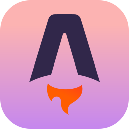
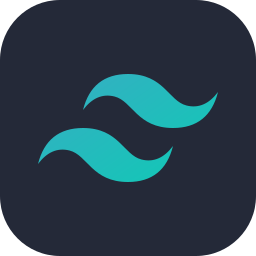
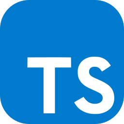
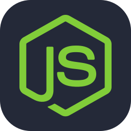
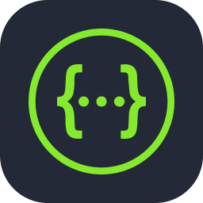
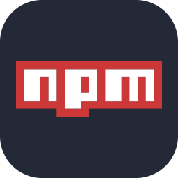
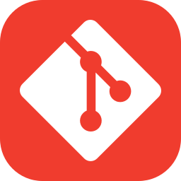
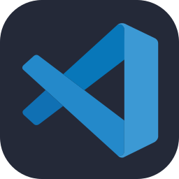

<p align="center">
  <picture>
    <source media="(prefers-color-scheme: dark)" srcset="docs/img/logo/logo-dark.png">
    
  </picture>
</p>
<h3 align="center">Registra tus entrenamientos de fuerza. Supera tus marcas. Compártelo.</h3>

<p align="center">
  
  
  
  
  
  
  
  
</p>

<p align="center">
  
</p>

## ¿Qué es AlFallo?

**AlFallo** es una aplicación web para quien entrena en el gimnasio. Llegas, pulsas **Empezar entrenamiento**, eliges qué vas a entrenar y, mientras haces cada ejercicio, apuntas las repeticiones y el peso de cada serie. Al terminar, la app guarda el entrenamiento con su duración, el número de series y el volumen total levantado.

Además, puedes crear **rutinas** (por ejemplo, *Torso / Pierna*) a partir de un catálogo común de ejercicios. Cada día de la rutina tiene un objetivo (fuerza, hipertrofia o resistencia), y la app comprueba que las series, repeticiones y descansos tengan sentido para ese objetivo.

Proyecto de la asignatura **Sistemas y Tecnologías Web** (Universidad de La Laguna, curso 2026/27).

## Demo

<p align="center">
  
</p>

## Funcionalidades

**Disponibles**

- Registro e inicio de sesión con JWT
- Perfil de usuario: consultar, editar, cambiar contraseña y eliminar la cuenta
- Catálogo de ejercicios por grupo muscular y dificultad
- Rutinas por días, con validación de series, repeticiones y descanso según el objetivo
- Entrenamiento en curso: empezar, registrar series (repeticiones y peso), terminar o descartar
- Historial de entrenamientos con duración, series y volumen calculados automáticamente
- Documentación interactiva de la API con Swagger

**Próximamente**

- Seguir a otros usuarios y feed con sus entrenamientos
- Ánimos y comentarios en los entrenamientos
- Estadísticas y récords personales
- Temporizador de descanso entre series

## Tecnologías

**Frontend**

<p>
  
  
  
  
  
</p>

**Backend y base de datos**

<p>
  
  
  
  
  
  
  
</p>

**Herramientas**

<p>
  
  
  
  
</p>

Además: **Mongoose** (modelos de datos), **JWT** y **bcrypt** (autenticación), **OpenAPI 3** (especificación de la API), **Supertest** (tests de la API), **Render** y **MongoDB Atlas** (despliegue), y **Jira** (gestión de los sprints).

## Estructura del repositorio

```text
ALFALLO/
├── client/            # Frontend (Astro + React + Tailwind)
│   ├── public/        # Imágenes y recursos estáticos
│   └── src/
│       ├── components/
│       ├── layouts/
│       ├── lib/       # Gestión de la sesión
│       └── pages/     # Cada archivo es una ruta de la web
├── server/            # API REST (Express + TypeScript)
│   ├── config/        # Variables de entorno (dev.env, test.env)
│   └── src/
│       ├── controllers/
│       ├── docs/      # Configuración de Swagger
│       ├── middlewares/
│       ├── models/    # Esquemas de Mongoose
│       ├── routes/
│       └── tests/
└── docs/img/          # Imágenes de este README
```

## Cómo ejecutarlo en local

**Requisitos:** Node.js 22 o superior y MongoDB funcionando en local (o una base de datos en MongoDB Atlas).

**1. Clona el repositorio**

```bash
git clone https://github.com/SyTW2627/ALFALLO.git
cd ALFALLO
```

**2. Levanta MongoDB**

La API necesita un servidor de MongoDB en marcha antes de arrancar. Elige una de estas opciones:

<details>
<summary><b>Linux (paquete <code>tgz</code>)</b></summary>

<br>

Descarga **MongoDB Community Server** para tu distribución desde [mongodb.com/try/download/community](https://www.mongodb.com/try/download/community). Elige el paquete `tgz`; por ejemplo, para Ubuntu 24.04:

```bash
cd ~
wget https://fastdl.mongodb.org/linux/mongodb-linux-x86_64-ubuntu2404-8.0.8.tgz
tar xzvf mongodb-linux-x86_64-ubuntu2404-8.0.8.tgz
rm mongodb-linux-x86_64-ubuntu2404-8.0.8.tgz
mv mongodb-linux-x86_64-ubuntu2404-8.0.8 mongodb
```

Crea la carpeta donde MongoDB guardará los datos:

```bash
mkdir ~/mongodb-data
```

Y arranca el servidor (deja esta terminal abierta mientras uses la app):

```bash
~/mongodb/bin/mongod --dbpath ~/mongodb-data
```

Si da un error de permisos, ejecútalo con `sudo`.

</details>

<details>
<summary><b>Windows o macOS</b></summary>

<br>

Descarga el instalador de **MongoDB Community Server** desde [mongodb.com/try/download/community](https://www.mongodb.com/try/download/community) y sigue el asistente. En Windows, marca la opción de instalarlo como servicio: así se arranca solo con el ordenador. En macOS también se puede instalar con Homebrew:

```bash
brew tap mongodb/brew
brew install mongodb-community
brew services start mongodb-community
```

</details>

<details>
<summary><b>Con Docker</b></summary>

<br>

```bash
docker run -d --name alfallo-mongo -p 27017:27017 mongo
```

</details>

En cualquiera de los casos, MongoDB queda escuchando en `mongodb://127.0.0.1:27017`, que es la dirección que usa la configuración del backend.

**3. Backend**

Arranca la API:

```bash
cd server
npm install
npm run dev
```

La API queda en `http://localhost:3000` y la documentación en `http://localhost:3000/api-docs`.

**4. Frontend** (en otra terminal)

```bash
cd client
npm install
npm run dev
```

La web queda en `http://localhost:4321`.

### Scripts

| Carpeta | Comando | Qué hace |
|---|---|---|
| `server` | `npm run dev` | Arranca la API y la reinicia al guardar cambios |
| `server` | `npm run build` | Compila TypeScript a `dist/` |
| `server` | `npm start` | Arranca la versión compilada |
| `server` | `npm test` | Ejecuta los tests (usa `config/test.env`) |
| `client` | `npm run dev` | Arranca la web en modo desarrollo |
| `client` | `npm run build` | Genera la versión de producción |

## API

Toda la API está documentada en **Swagger**, donde se puede probar cada endpoint desde el navegador:

- Local: `http://localhost:3000/api-docs`

| Recurso | Endpoints principales |
|---|---|
| Autenticación | `POST /api/auth/register` · `POST /api/auth/login` |
| Usuario | `GET` `PUT /api/users/profile` · `PATCH /api/users/change-password` · `DELETE /api/users/account` |
| Ejercicios | `GET` `POST /api/exercises` |
| Rutinas | `GET` `POST /api/routines` · `GET` `PUT` `DELETE /api/routines/:id` |
| Entrenamientos | `POST /api/workouts/start` · `GET` `PUT` `DELETE /api/workouts/active` · `POST /api/workouts/finish` · `GET /api/workouts/history` |

Todas las rutas, salvo el registro y el inicio de sesión, necesitan la cabecera `Authorization: Bearer <token>`.

## Metodología

Trabajamos con **Scrum** en sprints semanales, organizados en Jira con épicas, tareas estimadas en story points y un tablero con columna de pruebas. En Git, cada parte se desarrolla en su rama y se integra en `develop`. `main` se actualiza al cerrar cada sprint.

## Equipo

| Nombre | Rol principal |
|---|---|
| **Iker Martín Gámez** | Backend y base de datos |
| **Hugo Martín Gámez** | Frontend y diseño |
| **Aitor Castro Darias** | Modelo de datos e integración |
